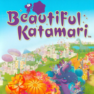

<div align=center>



</div>
<h1 align=center>katamari-nx installer</h1>

The installer page of [katamari-nx](https://github.com/ChanseyIsTheBest/katamari-nx), the native Nintendo Switch port of
Beautiful Katamari (Xbox 360): **https://chanseyisthebest.github.io/katamari-nx-installer/**

You give it your own copy of the game (the disc image, or a folder you extracted it into), with the DLC packages if you
have them, and it gives you `katamari-nx.zip`, ready to extract into `sdmc:/switch/`. Everything runs in your browser:
the game files never leave your computer.

Since 1.0.2 the page is [renut_nx_ultimate_installer](https://github.com/ChanseyIsTheBest/renut_nx_ultimate_installer)'s,
the installer of the ports made from the ultimate base, with Beautiful Katamari's `game.json`.

## What it does

1. Finds the game in what you chose: a disc image (`.iso`, read in place: `lib/xiso.js`) or a folder with
   `default.xex`, and checks that the copy is whole (`lib/game_check.js`: every file of the build, with its size).
2. Identifies the game by the SHA-256 of `default.xex` and picks its build from `release/manifest.json`.
3. Downloads that build's NRO and release files and checks each one's SHA-256.
4. Makes the shaders of the deko3d renderer (the NRO holds no shader of the game and reads `deko3d_glsl.bin` beside
   itself): 111 of Beautiful Katamari's 195 shaders are in `default.xex`, 84 inside the models of `d02.dat`-`d05.dat`
   (the build's entry lists the 57 records that hold them). Each one goes through the base's own chain in the page
   (Renut's translator, DXC, SPIRV-Cross, the base's Python passes in Pyodide), and the console's DKSH cache is
   compiled from the variants the release lists (`deko3d_shaders.bin`, with `pipeline_list.bin`), so the game meets
   few shaders it has to compile itself.
5. Packs the game's files as LZ4 blocks (the movies as ZXC), re-encodes the music and voices to Opus (the browser's
   encoder) and, if your browser has an H.265 encoder (Chrome or Edge on a recent graphics card), the movies to H.265,
   which the Switch's video hardware plays. Beautiful Katamari: about 1.6 GB on the SD card instead of 2.9 GB.
6. Writes the game folder's index (`cache/vfs_index_game_root.bin`), so the first start skips the folder scan.
7. Streams the zip to disk through the service worker, so a whole disc never has to fit in memory.

The zip holds `katamari-nx/katamari-nx.nro` with its `LICENSES.txt`, the shader files, the game in `game_root/` and, if
you chose them, the DLC packages in `dlc/` (the game reads them in place). It holds no `katamari.toml`: the game writes
it at its first start, so extracting a new zip never overwrites your settings.

## Deployment

The NRO is not stored here: it is the `katamari-nx.nro` asset of a release of the katamari-nx repository of the same
owner. The workflow in `.github/workflows/deploy.yml` downloads it from the latest release, checks it and the other
release files against `release/manifest.json` (`.github/verify_release.mjs`) and publishes the page on GitHub Pages. It
runs on every push to `main`; after publishing a new release, run it by hand from the Actions tab.

A new build's release files are made in renut_nx_ultimate_installer with `tools/make_release.py` (the NRO, the shader
records from katamari-nx's `tools/katamari_shader_files.py`, a pipeline list) and `test/full_node.mjs --reference`, as
its README describes, and copied here with the rest of the page.

## Testing locally

Put `katamari-nx.nro` in `release/` and serve the folder:

```sh
python serve.py 8193
```

Then open http://127.0.0.1:8193/. The same code runs in Node and in a headless browser (`test/full_node.mjs`,
`test/browser.html` with `serve.py --test-files`; `test/check_zip.py` checks a zip against the game).

## License

GPL-3.0 (see [LICENSE](LICENSE)). Third-party components are listed in [NOTICES.md](NOTICES.md). The page is built on
renut_nx_ultimate_installer, itself built on the installers of rr6-nx, kameo-nx, banjo-nx, blur-nx, futari-nx and
sa2-nx, and on [nfsmw-nx-installer](https://github.com/StevensND/nfsmw-nx-installer) by StevensND.

Beautiful Katamari is a trademark of Bandai Namco Entertainment; the icon artwork is © Bandai Namco. This project is not
affiliated with or endorsed by Bandai Namco, Nintendo or Microsoft.
